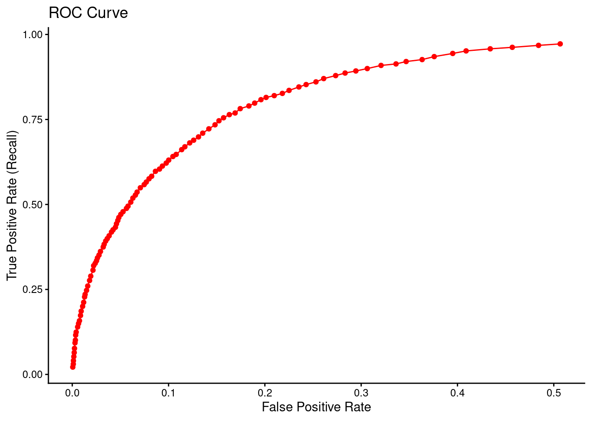
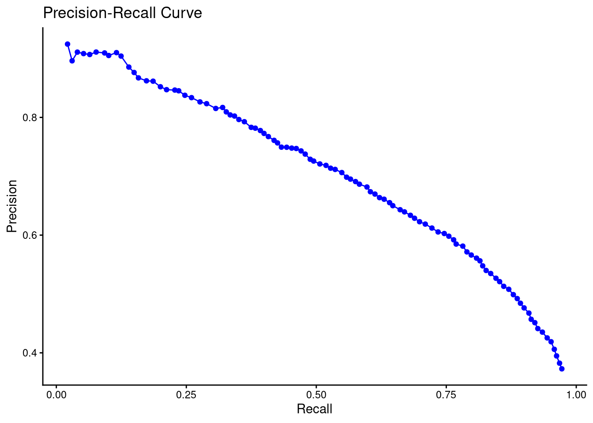

# m6APrediction

`m6APrediction` is an R package for predicting **N6-methyladenosine (m6A) RNA modification sites** using a random forest model. It accepts sequence and transcript-annotation features and provides both multiple-sample and single-sample predictions.

The package was developed for BIO215 and packages the prediction functions and fitted model used in the m6A Shiny project into a reusable R tool.

## Installation

Install the package directly from GitHub:

```r
# Using remotes
install.packages("remotes")
remotes::install_github("RUIQING6/m6APrediction")

# Or using devtools
devtools::install_github("RUIQING6/m6APrediction")
```

Then load the package:

```r
library(m6APrediction)
```

## Input features

The prediction model uses seven input features:

- `gc_content`
- `RNA_type`
- `RNA_region`
- `exon_length`
- `distance_to_junction`
- `evolutionary_conservation`
- `DNA_5mer`

## Multiple-sample prediction

The package includes an example dataset and fitted random forest model in `inst/extdata`.

```r
library(m6APrediction)

ml_fit <- readRDS(system.file(
  "extdata", "rf_fit.rds",
  package = "m6APrediction"
))

example_data <- read.csv(system.file(
  "extdata", "m6A_input_example.csv",
  package = "m6APrediction"
))

predicted <- prediction_multiple(
  ml_fit,
  example_data,
  positive_threshold = 0.5
)

head(predicted)
```

The returned data frame contains the original input features plus:

- `predicted_m6A_prob`: predicted probability of the Positive class.
- `predicted_m6A_status`: Positive or Negative according to the selected threshold.

## Single-sample prediction

```r
prediction_single(
  ml_fit = ml_fit,
  gc_content = 0.6,
  RNA_type = "mRNA",
  RNA_region = "CDS",
  exon_length = 12,
  distance_to_junction = 5,
  evolutionary_conservation = 0.8,
  DNA_5mer = "GGACA",
  positive_threshold = 0.5
)
```

## Model performance

In the course model evaluation, the random forest classifier achieved an **AUROC of 0.8868** and an **AUPRC of 0.7057** on the testing dataset. These values were above the corresponding baselines (0.5000 for ROC and 0.2365 for PRC).

### ROC curve



### Precision-recall curve



## Documentation

After installation, open the function help pages with:

```r
?prediction_multiple
?prediction_single
```

## Notes

This package is intended for research and educational use. Model predictions are computational estimates and should not be interpreted as clinically validated diagnostic results.
